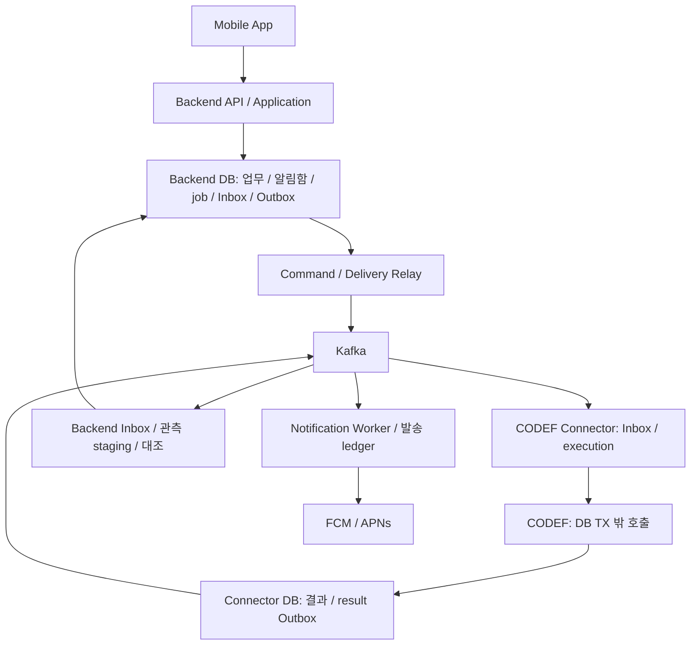
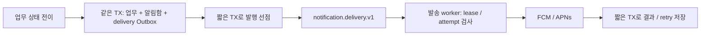
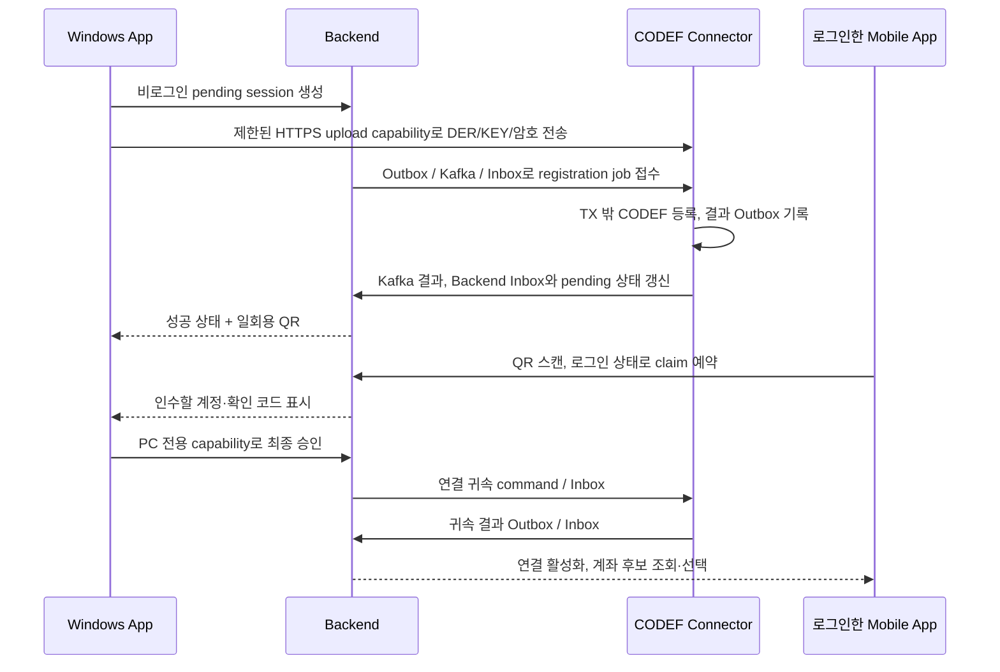

# HowMuch Kafka·CODEF·공동인증서 연결 설계 보고서

- 작성일: 2026-10-06, Asia/Seoul
- 상태: 설계 제안 완료 / 기능 구현 전
- 범위: 본인 담당 Notion 알림 요구사항, Kafka 알림, CODEF Connector Inbox/Outbox, Windows 인증서와 모바일 QR 연결
- 조사 기준: Backend `feat/ci-dev-pve-target`, HEAD `ccc87538`; Connector `codex/backend-sdk-integration`, HEAD `4cf5824`
- 수행: 컴퓨터 Notion 직접 열람, 현재 코드와 스키마 조사, 공식 기술 자료 확인, 세 분야 서브에이전트 검토
- 제외: Java·SQL·배포 설정 변경, 인증서 실파일 열람·업로드, 실은행 호출, commit/push/PR

## 1. 먼저 결정한 방향

**알림은 기존 알림함·발송 Outbox를 유지하고 Kafka로 발송 worker를 분리한다. CODEF는 전용 Connector와 DB를 두고 요청·결과 양쪽에 Inbox/Outbox를 반드시 적용한다. Windows에서는 로그인 없이 공동인증서를 등록하고, 모바일의 로그인 계정으로 일회용 QR 연결권을 인수하되 PC에서 최종 승인한다.**

이 방향은 세 문제를 해결한다. 알림 발송 장애를 사용자 API와 분리하고, 느린 CODEF 조회가 화면과 DB 잠금을 붙잡지 않게 하며, PC에 있는 인증서를 모바일로 복사하지 않고 금융 연결 결과만 계정에 귀속시킨다.

| 결정 | 선택 | 이유와 대가 |
|---|---|---|
| 알림 처리 | 알림함 저장은 동기 DB TX, 푸시 실행은 Kafka worker | 저장 성공의 의미를 유지하면서 실행 프로세스를 분리. broker 운영 비용 증가 |
| 알림 consumer Inbox | 같은 DB의 발송 ledger가 중복·lease·attempt를 제어하면 별도 테이블 생략 | 사용자 알림함은 계속 필요. DB를 분리하면 수신 Inbox 추가 |
| CODEF 경계 | Backend command Outbox → Connector Inbox/job → CODEF → result Outbox → Backend Inbox | 서비스별 DB 원자성과 장애 복구. 최종 결과가 늦게 보이는 UX 필요 |
| 거래 확정 | 관측 staging → 완전성 검사 → 대조 → 확정 | 안정 거래 ID가 확인되지 않은 데이터의 중복·메모 변경 처리. 모호한 결과는 보류 |
| 인증서 UX | PC-first, 등록 성공 뒤 QR, 모바일 claim 예약, PC 승인 | PC 로그인 생략을 유지하면서 QR 탈취에 의한 무단 귀속 방어. 승인 한 단계 추가 |
| QR 내용 | 짧은 수명의 무작위 일회용 연결권 | `connectedId`, 인증서, 비밀번호, 앱 JWT를 담지 않음. 서버 상태 저장 필요 |
| Windows 앱 | .NET WPF, 사용자가 선택한 경로에서 읽기 | Windows 전용 목적에 맞는 작은 앱. 팀의 C# 개발·코드서명 부담 |
| Relay | DB polling부터 시작 | 기존 구조 재사용과 장애 재현이 쉬움. 병목을 측정한 뒤 CDC 평가 |

Kafka를 도입한다고 자동으로 호출 수가 줄거나 푸시가 정확히 한 번 표시되지는 않는다. 호출 감소는 single-flight와 freshness 정책이, 거래 정확성은 대조 정책이, 외부 호출 복구는 job 상태가 각각 책임진다.

## 2. Notion에서 확인한 본인 담당 알림

컴퓨터의 Notion **기능 명세서 v4**에서 각 상세 페이지의 `담당자 = 현승민 학생`과 진행 상태를 직접 확인했다. 상위 분류 ALM/STL/GRO는 기능 개수에서 제외했다. 연결된 MCP는 해당 workspace 페이지를 읽지 못해 실제 Notion 앱의 상세 속성으로 확인했다. 페이지 내용과 담당자·상태는 수정하지 않았다.

### 새로 만들 기능 5개

| ID | 현재 상태 | 트리거와 수신자 | 화면 이동 | 개발 판단 |
|---|---|---|---|---|
| [ALM-STL-004](https://www.notion.so/3ea0c4c8e4e4817597bfcd461603f169) 송금 완료 | 시작 전 | 참여자의 송금 확인 → 정산 생성자 | 정산 상세 | 우선 구현. 입금 확정/몫 완납 전이와 같은 TX에서 기록 |
| [ALM-STL-005](https://www.notion.so/3ea0c4c8e4e4816b8f5bdd687d80576d) 정산 완료 | 시작 전 | 모든 참여자의 송금 확인으로 종료 → 참여자 전원 | 정산 상세 | 우선 구현. 최초 `COMPLETED` 전이만 발행 |
| [ALM-GRO-001](https://www.notion.so/dc00c4c8e4e4828d9e43811701422e2f) 그룹 초대 | 시작 전 | 특정 회원에게 초대 → 해당 회원 | 가입 확인 후 그룹 상세 | 초대 대기/수락 계약이 선행. 코드·링크 공유만으로 수신자 식별 불가 |
| [ALM-GRO-002](https://www.notion.so/3ea0c4c8e4e4814e8827fbe242d5ee75) 그룹 탈퇴 | 시작 전 | 탈퇴 commit → 남은 그룹 멤버 전원 | 그룹 상세 | 그룹 탈퇴 UseCase와 알림 생성 연결 |
| [ALM-RCP](https://www.notion.so/a430c4c8e4e4823c87c981173d6ae0ae) 리캡 도착 | 시작 전 | 매월 1일 전월 리캡 집계 완료 → 리캡 생성 회원 | 해당 월 리캡 | 리캡 저장/공개가 선행. 전월 완료 정산 1건 이상 기준 |

### 이미 완료된 기능과 회귀 기준

| ID | 완료된 요구사항 | 유지할 동작 |
|---|---|---|
| [ALM-STL-001](https://www.notion.so/d530c4c8e4e483f8a47d819478e78f18) | 정산 요청 → 회원 참여자 알림 | 정산 참여 화면 이동 |
| [ALM-STL-002](https://www.notion.so/ce20c4c8e4e482eaa28b81438d84f99f) | 생성자가 미납 회원에게 독촉 | 비회원에게 앱 알림 없음; 링크 직접 공유 |
| [ALM-STL-003](https://www.notion.so/d2d0c4c8e4e482edbbac81b3c3e29525) | 미참여 회원에게 12시간 주기 리마인드 | KST 03:00~06:00 제외, 해당 시간 예약은 06:00로 연기, 삭제된 정산 제외 |
| [ALM-001](https://www.notion.so/3e70c4c8e4e48167a8f9f032802ad9b7) | 알림 목록·읽음·푸시 클릭 | 이어 불러오기, 로그인 시 기기 등록/로그아웃 시 해제, 삭제된 정산 알림은 보존하고 이동 비활성 |

**문서와 코드의 차이:** Notion은 특정 회원 초대 기능이 없다고 적지만, 현재 Backend에는 `publicId`로 멤버를 즉시 `ACTIVE`로 추가하는 API가 있다. 이것은 상대방의 수락을 기다리는 초대가 아니다. 따라서 ALM-GRO-001의 “가입 확인 후 이동”을 구현하려면 `PENDING → ACCEPTED/DECLINED/EXPIRED` 초대 모델을 별도로 정의한다. 즉시 가입 알림으로 요구를 바꾸려면 제품 명세도 함께 바꿔야 한다. [현재 GroupController](/Users/wars/Github/howmuch/howmuch-backend-v2/src/main/java/com/amateur/howmuchbackend/adapter/in/web/group/GroupController.java:143)

리캡 본체는 Notion에서 다른 담당자의 시작 전 기능이다. 알림 담당자가 리캡 집계까지 다시 만드는 대신 `RecapPublished` 계약으로 연결한다. CODEF 인증 만료·연동 완료 알림은 이번에 확인한 다섯 항목에 없으므로 **별도 확장 후보**로만 둔다.

리마인드의 “06:00로 연기”는 요구사항이다. 현재 코드는 금지 시간에 생성을 건너뛰고 다음 scheduler poll에서 due 대상을 다시 찾는다. 정확한 06:00 예약 발송과는 다르다. Kafka 대기 때문에 금지 시간 전에 만든 알림도 늦게 전송될 수 있으므로 생성 금지와 실제 push 발송 금지를 별도 정책으로 정의한다. 금지 시간에 소비한 리마인드는 DB의 다음 발송시각을 06:00 KST로 연기하고 worker가 다시 검사하도록 한다.

## 3. 현재 방식과 실제 구현 수준

| 영역 | 이번에 확인한 현재 상태 | 목표와의 차이 |
|---|---|---|
| 사용자 알림함 | 목록·미읽음 수·본인 읽음 API와 `user_notifications` 있음 | 새 종류·그룹·리캡 target 필요 |
| 알림 생성/전송 | `NotificationRecorder`가 알림함+`settlement_notification_outbox`를 같은 TX에 저장. 1초 polling worker가 FCM/APNs 호출 | 이미 비동기 전송. Kafka의 목적은 실행 분리와 확장 |
| Kafka 알림 | 현재 Backend build에 `spring-kafka`와 producer/listener 없음 | 신규 연결·worker 실행 프로필·운영 설정 필요 |
| 알림 생성 Outbox | V38 SQL만 있고 해당 Java 사용 경로 없음 | 생성까지 비동기화는 선택안, 현재 기능으로 계산하지 않음 |
| 계좌 화면/정산 대조 | Backend가 직접 CODEF를 조회. 일부 TX/잠금 안에서 외부 호출 | local read와 외부 수집을 분리해야 함 |
| 금융 비동기 Backend | V32/V33에 job/outbox/inbox/chunk/ref/version 테이블 있음 | 현재 checkout에 관련 Java producer/consumer/대조 구현 없음 |
| 금융 Connector | Kafka intake·Inbox/execution/Outbox·CODEF collector 있음 | retry·stale 회수 불완전. 비어 있지 않은 거래 결과가 안정 ID 요구로 차단됨 |
| 공동인증서 | 현재 Backend Adapter는 `loginType=1` ID/PW 방식 | `loginType=0`, pending registration, QR 귀속, 인증서 보안 경계 신규 |
| 모바일 알림 모델 | 요청/리마인드 두 종류와 정산 참여 이동에 맞춰져 있음 | 새 상세/그룹/초대/리캡 target별 분기 필요 |

현재 구조의 장점을 없앨 필요는 없다. 알림함의 DB 저장, 멱등 business key, 발송 작업 선점, 재시도 정책은 재사용한다. Connector의 command intake와 별도 실행 worker, 결과 Outbox도 재사용한다. 다만 **SQL 존재, Java 구현, 실제 실행, 운영 활성화, 실은행 성공은 각각 다른 완료 상태**다.

예전 작업 기록에는 거래 관측 v2와 대조 실험이 있지만 현재 확인한 tree에서 해당 구현을 찾지 못했다. 당시 테스트 결과를 현재 코드의 성공 증거로 사용하지 않았다. 재사용할 때 별도 작업물 회수와 계약 검증이 먼저 필요하다.

현재 알림 근거: [NotificationRecorder](/Users/wars/Github/howmuch/howmuch-backend-v2/src/main/java/com/amateur/howmuchbackend/application/notification/service/NotificationRecorder.java:17), [Outbox Worker](/Users/wars/Github/howmuch/howmuch-backend-v2/src/main/java/com/amateur/howmuchbackend/application/settlement/service/SettlementNotificationOutboxWorker.java:82), [V38](/Users/wars/Github/howmuch/howmuch-backend-v2/src/main/resources/db/migration/V38__create_notification_creation_outbox.sql:1).

현재 금융 근거: [AccountQueryService](/Users/wars/Github/howmuch/howmuch-backend-v2/src/main/java/com/amateur/howmuchbackend/application/account/service/AccountQueryService.java:206), [SettlementDepositService](/Users/wars/Github/howmuch/howmuch-backend-v2/src/main/java/com/amateur/howmuchbackend/application/settlement/service/SettlementDepositService.java:54), [Backend V32](/Users/wars/Github/howmuch/howmuch-backend-v2/src/main/resources/db/migration/V32__create_account_transaction_sync_schema.sql:45), [Connector Intake](/Users/wars/Github/howmuch/howmuch-finance-connector/src/main/java/com/amateur/howmuchfinanceconnector/application/sync/service/FinanceCommandIntakeService.java:23), [Collector](/Users/wars/Github/howmuch/howmuch-finance-connector/src/main/java/com/amateur/howmuchfinanceconnector/adapter/out/codef/CodefBankTransactionCollector.java:117), [AMBIGUOUS 판정](/Users/wars/Github/howmuch/howmuch-finance-connector/src/main/java/com/amateur/howmuchfinanceconnector/application/sync/service/FinanceCollectionService.java:61).

## 4. 기술을 이해하는 데 필요한 개념

| 용어 | 쉬운 설명 | 해결하는 문제 |
|---|---|---|
| Kafka | 이벤트를 보관하고 각 소비자가 자신의 위치부터 읽는 로그 | 작업 전달, 독립 소비, 장애 뒤 재생 |
| Topic / Partition | 종류별 통로 / 병렬로 읽는 단위 | 이벤트 구분과 처리량 분배 |
| Key / Consumer group | 같은 대상의 partition 선택값 / 같은 역할 worker 집합 | 업무 대상의 묶음과 실행 분담 |
| Offset | 소비자가 어디까지 읽었는지 나타내는 위치 | 재시작 때 이어 읽기 |
| Transactional Outbox | 업무 변경과 함께 DB에 남긴 발행 의도 | DB 성공 직후 broker 실패로 이벤트 유실 |
| Consumer Inbox | 수신 eventId와 local 처리를 같은 TX에 기록한 원장 | 재전달이 같은 DB 효과를 반복하는 문제 |
| 사용자 알림 Inbox | 제목·내용·읽음 상태를 보관하는 알림함 | 푸시를 놓쳐도 사용자가 확인 |
| Job / Lease / Fencing | 실행 상태 / 한시적 실행 권한 / 오래된 실행자의 쓰기 차단 | worker 종료·중복 실행·늦은 결과 |
| Staging / Reconciliation | 수집 결과 임시 보관 / 기존 거래와 대조해 확정 | 불완전 수집과 거래 동일성 문제 |

예를 들어 DB에 정산 요청은 저장했는데 Kafka 전송 전에 서버가 꺼질 수 있다. Outbox가 있으면 재시작 뒤 아직 보낼 일을 찾는다. 반대로 Kafka가 접수했는데 DB에 발행 완료를 적기 전에 서버가 꺼지면 같은 이벤트가 다시 발행된다. Inbox 또는 동등한 처리 ledger가 그 재전달을 막는다.

**Kafka 내부 exactly-once와 금융 시스템 전체 exactly-once는 다르다.** PostgreSQL commit, CODEF 등록, FCM/APNs 접수는 Kafka 트랜잭션에 자동 포함되지 않는다. 선택한 보장은 at-least-once 전달, local DB 효과의 멱등 처리, 외부 성공 불명확 상태의 명시적 복구다. [Apache Kafka 전달 보장](https://kafka.apache.org/41/design/design/#message-delivery-semantics), [Spring Kafka 트랜잭션](https://docs.spring.io/spring-kafka/reference/kafka/transactions.html)

## 5. 전체 구조와 책임

Backend는 사용자 인증, 계좌 소유권, 확정 거래·합계, 정산, 알림 대상과 문구를 소유한다. Connector는 CODEF OAuth·기관별 요청·자격정보, 수집 제한·재시도와 기술 결과를 소유한다. **Connector가 직접 정산을 완료시키거나 사용자에게 입금 완료 푸시를 보내지 않는다.** Backend가 수집 자료를 확정하고 업무 전이를 판단한 뒤 알림을 만든다.

Backend와 Connector는 서로의 DB 테이블을 읽거나 쓰지 않는다. 같은 PostgreSQL 서버를 쓰더라도 DB 계정과 소유권을 분리한다. 알림 worker는 초기에는 같은 코드베이스의 별도 실행 프로필/프로세스로 Backend DB의 발송 ledger에 접근한다. 이것은 별도 DB를 가진 독립 알림 서비스와 다른 배포 선택이다.

Application은 `PublishFinanceCommandPort`, `SendNotificationPort`처럼 실제 외부 대화의 Port를 사용하고 Kafka·CODEF DTO는 Adapter에 둔다. Domain/Application에 Kafka client나 JPA Entity를 넣지 않는다. 정책은 Application이 소유하고 Infra는 topic·client·properties·bean wiring만 맡는다. [저장소 구조 규칙](../../architecture.md)

## 6. 알림 아키텍처와 기능 설계

### 6.1 기본 경로: 저장은 유지, 발송 실행 분리

Kafka에는 `eventId`, `outboxId`, `schemaVersion`, `attemptCount`, `occurredAt`, `correlationId` 같은 작업 참조만 담는다. 수신자의 token, 정산 링크 token, 제목·본문은 DB에서 읽는다. topic key는 `recipientUserId`, consumer group은 `notification-delivery-v1`로 한다. 임의 사용자별 topic이나 group은 만들지 않는다.

같은 DB의 Outbox row를 소비 전에 원자 선점하고 완료 상태·lease·attempt를 확인한다면 별도 consumer Inbox 테이블을 생략할 수 있다. **이 역할을 현재 `PROCESSING` 상태 하나로 곧바로 구현할 수 있다는 뜻은 아니다.** 발행 선점과 외부 전송 선점을 구분할 상태/시각/lease token을 설계해야 한다.

기본 흐름은 짧은 선점 TX → 외부 push 호출 → 짧은 결과 TX다. 현재 worker가 정산 row lock을 잡고 외부 호출하는 경계는 분리한다. 발송 직전에 삭제·회원 상태·token 유효성을 재확인하되, 이미 시작한 외부 호출까지 회수하는 보장은 하지 않는다.

업무 재시도의 기준은 DB Outbox로 통일한다. provider 일시 오류는 `RETRY + nextAttemptAt`을 저장하고 해당 Kafka record를 처리 완료한 뒤, relay가 다음 attempt를 발행한다. Kafka retry topic에서도 같은 횟수를 중첩해서 반복하지 않는다. schema 오류는 DLT로 격리하되 DLT 발행이나 durable error 기록이 실패하면 offset을 먼저 완료하지 않는다.

**broker 발행 retry와 provider delivery attempt는 분리한다.** 발행 실패는 durable pending 상태에서 capped backoff로 재시도하고, 실제 provider 호출이 시작될 때만 delivery attempt를 증가시킨다. broker 장애로 현재의 최대 5회 발송 정책을 소진하지 않는다. Kafka 발행/대기 시간에는 provider `PROCESSING` lease를 적용하지 않고 별도 발행 lease와 대기 상태로 관리한다.

### 6.2 새 알림의 트리거와 중복 기준

| 기능 | 발행 기준 | Business dedup key 예시 | 구현 주의 |
|---|---|---|---|
| 송금 완료 | 확인된 입금으로 해당 몫이 최초 완납 | `SHARE_PAID:{shareId}` | 버튼 클릭, 수집 완료, 추정 매칭, 부분 납부는 완료 근거 아님 |
| 정산 완료 | 최초 `COMPLETED` 전이 | `SETTLEMENT_COMPLETED:{settlementId}` | 상태를 재조회/이벤트 replay해도 새 알림 금지 |
| 그룹 초대 | 특정 회원 invitation 최초 생성 | `GROUP_INVITATION:{invitationId}` | 상대방이 아직 가입자가 아니므로 invitation 조회/수락 권한 필요 |
| 그룹 탈퇴 | 탈퇴 commit 후 남은 멤버 대상 | `GROUP_MEMBER_LEFT:{membershipId}:{exitVersion}` | 탈퇴자 제외, 재가입 후 탈퇴는 별도 이력 |
| 리캡 도착 | 해당 월 리캡 저장·공개 성공 | `RECAP_PUBLISHED:{userId}:{yearMonth}` | 스케줄러 실행 시작이나 집계 실패에서는 발행 금지 |

키는 제안이며 실제 모델의 ID·상태 전이에 맞춰 확정한다. 모두 수신자와 함께 UNIQUE로 묶는다. 송금/정산 완료의 삽입점은 현재 `SettlementDepositWriter`의 입금 저장·완료 전이 TX다. 직전과 직후의 완납 상태를 비교해야 한다. [현재 확정 구간](/Users/wars/Github/howmuch/howmuch-backend-v2/src/main/java/com/amateur/howmuchbackend/application/settlement/service/SettlementDepositWriter.java:145)

마지막 참여자의 송금으로 정산이 완료되면 004와 005는 서로 다른 업무 알림이다. 기본안은 두 기록을 생성하고, 생성자가 완료 수신자에도 포함될 경우 두 개를 받을 수 있다고 명시한다. 두 푸시를 하나로 합치는 것은 별도 문구/제품 정책이 필요하다. 비회원은 앱 알림 수신자가 될 수 없으므로 자동 SMS를 추가하지 않는다.

### 6.3 알림 모델을 범용으로 바꾸기

현재 enum과 V31 CHECK는 요청/리마인드 두 종류만 허용한다. Domain/DTO와 V29/V38은 정산 또는 배분 방식에 의존한다. 따라서 enum만 늘리면 그룹·리캡 알림이 동작하지 않는다.

현재 worker는 요청이 아니면 리마인드로 보내고, 목록 mapping은 리마인드가 아니면 요청 label로 해석한다. `allocationType`의 필수 제약과 `.name()` 호출도 정산 외 알림에 맞지 않는다. 범용화에는 schema·enum뿐 아니라 발송 분기, Web DTO, 목록과 push mapper를 함께 변경한다.

목표는 `notificationId`, `recipient`, `type`, title/body snapshot, readAt와 **typed target**을 가진 사용자 알림함, 그리고 `notificationId + recipient` 중심의 범용 delivery Outbox다. target은 `SETTLEMENT_PARTICIPATION`, `SETTLEMENT_DETAIL`, `GROUP_INVITATION`, `GROUP_DETAIL`, `MONTHLY_RECAP`을 구분한다. 필수 ID/월을 검증하고 존재·권한 확인이 실패하면 표시 기록을 보존하면서 action을 비활성화한다.

모바일도 새 알림 종류와 이동 분기를 함께 바꿔야 한다. 기존 클라이언트용 정산 필드는 호환기간 동안 유지하고 모르는 종류는 안전한 목록 항목으로 표시한다. [현재 타입](/Users/wars/Github/howmuch/howmuch-frontend-v2/src/entities/notification/api/types.ts:1), [현재 참여 화면 분기](/Users/wars/Github/howmuch/howmuch-frontend-v2/src/entities/notification/lib/getNotificationParticipationParams.ts:9)

### 6.4 알림 생성까지 비동기화하는 선택안

대량 fanout이나 독립 알림 서비스가 필요하면 업무 TX에는 `notification_creation_outbox`만 남기고 consumer가 알림함+delivery Outbox를 생성한다. 현재 V38은 정산 전용 스키마만 있어 범용화와 Java 구현이 필요하다.

이때 알림함이 잠시 늦게 보이고, 자동 리마인드가 이미 예약된 pending 의도를 알아야 한다. 현재 최신 알림 생성 시각 기반 계산에 pending creation을 제외하면 중복 예약 또는 주기 왜곡이 생길 수 있다. 첫 도입에서 발송만 분리하는 이유가 이 변경 범위를 줄이는 데 있다.

## 7. CODEF Connector: Inbox/Outbox 필수 구조

### 7.1 요청에서 최종 확정까지

1. Backend가 인증·소유권을 확인하고 `job + command Outbox`를 같은 TX에 저장한다. 앱에는 jobId와 접수 상태를 반환한다.
2. relay가 고정 messageId/payload로 발행한다. 현재 `finance.sync.command.v1` 수집 명령을 재사용하고 새 연결 명령은 별도 계약으로 둔다.
3. Connector listener는 `Inbox + execution + accepted result Outbox`를 한 TX에 저장하고 offset을 완료한다. 긴 CODEF 호출은 listener가 수행하지 않는다.
4. worker가 execution lease를 짧은 TX로 확보한다. CODEF 호출은 TX 밖에서 수행한다.
5. 완료 TX에서 active·connectionVersion·leaseVersion을 재검사하고 관측 결과와 result Outbox를 원자 저장한다.
6. 결과를 `finance.sync.event.v2` 관측 계약으로 전달한다. Backend는 `Inbox + chunk/manifest staging`을 한 TX로 저장한다.
7. 모든 chunk와 coverage가 맞으면 대조한다. 확정 거래·월 summary·job 성공을 한 TX로 반영한다. 필요한 정산 전이와 알림 의도는 해당 업무 TX에 남긴다.

기존 `finance.sync.event.v1`은 안정 providerTransactionId를 요구한다. 현재 CODEF collector가 그 ID를 만들 수 없고 비어 있지 않은 결과를 `AMBIGUOUS`로 차단한다. 날짜·금액·메모 hash를 provider가 발급한 ID라고 포장하지 않는다. v2 관측 계약과 Backend consumer를 먼저 준비하고 producer를 전환한다. Connector outbox의 v1 topic/schema CHECK도 확인·변경해야 한다.

연결/인증서 명령은 `finance.connection.command.v1`와 결과 topic 같은 별도 계약을 제안한다. 거래 수집 command에 비밀번호 필드를 추가하는 방법은 피한다. 이름·payload·migration은 후속 Feature Plan에서 확정한다.

### 7.2 화면 읽기와 수집 작업 분리

계좌 화면은 마지막 확정 거래와 `lastSyncedAt`을 즉시 읽는다. 갱신이 필요하면 job을 접수하고 `syncing`, 보류, 재인증 필요 상태를 보여준다. 새로고침을 반복해도 같은 계좌의 활성 작업으로 합친다. 기존 작업 범위 밖의 요청은 다음 작업으로 남기며 실행 중 payload를 바꾸지 않는다.

현재 Redis freshness marker는 성공 후 1분 유효기간을 표시하며 실행 중 요청을 합치는 장치가 아니다. 계좌당 활성 job UNIQUE와 요청 idempotency로 single-flight를 보장하고, 기관·connectionRef별 동시수와 provider 전체 호출 예산을 제한한다. 계좌 key 하나로 같은 connectedId에 묶인 모든 호출 제한이 해결되지는 않는다.

### 7.3 거래 동일성은 별도 대조 정책

Inbox는 같은 이벤트 재전달을 막지만 다른 job이 다시 조회한 같은 은행 거래를 알아보지는 못한다. 현재 Backend 거래 hash에는 description이 들어가 메모 변경만으로 새 거래로 인식될 수 있다. [현재 AccountTransactionKey](/Users/wars/Github/howmuch/howmuch-backend-v2/src/main/java/com/amateur/howmuchbackend/application/account/AccountTransactionKey.java:18)

v2는 시각·입출금·금액·잔액·설명 슬롯·관측 순서·조회 범위를 보존한다. 기존 거래와 앞뒤의 식별 가능한 거래 문맥을 비교해 유일한 메모 변경이면 기존 거래 ID와 정산 연결을 유지한다. 확실한 신규 거래만 추가하고, 구분할 수 없는 같은 금액·시각의 반복 거래는 임의 병합하지 않는다.

요청 전후 최대 7일 문맥과 최대 31일 수집 구간은 시작점으로 제안하는 **우리 정책값**이다. CODEF 전체 상품의 보장값이 아니다. 기관별 pagination/truncation/coverage와 chunk가 누락되면 `COLLECTING`에서 재수집하고 collection deadline을 넘으면 실패로 끝낸다. 모든 수집이 완전한 뒤 거래 의미만 모호한 경우 `APPLYING`에서 대조를 보류한다. 어느 보류 자료도 합계·정산 매칭·송금 완료 알림에 사용하지 않는다.

`APPLYING`은 계좌당 활성 job UNIQUE를 계속 점유한다. 동일 자료를 무한 대조하거나 이후 수집을 영구 차단하지 않도록 보류 이유, 제한된 추가 조회, 운영 검토와 취소/대체 job 절차를 둔다. 수집 deadline과 대조 보류의 검토 기한은 별도 정책이며, 기한 초과를 거래 확정 성공으로 바꾸지 않는다.

manifest가 chunk보다 먼저 와도 index 범위, 개수, hash, account/job/version, 총 item count가 맞기 전에는 확정하지 않는다. 빈 결과도 요청 범위가 완전히 조회된 성공 0건인지 확인한다. 같은 partition key만으로 여러 relay의 발행 순서까지 보장되지는 않는다.

### 7.4 꼭 보완할 실패 처리

| 상황 | 필요한 보장 |
|---|---|
| broker ACK 후 relay 종료 | 같은 ID로 재발행, Inbox가 중복 실행 차단 |
| Inbox commit 후 offset commit 전 종료 | 같은 local 결과를 다시 적용하지 않음 |
| CODEF 조회 timeout | 비용·deadline 안에서 제한 재수집 |
| CODEF create/add/update timeout | `UNKNOWN`으로 분리, 무조건 재등록 금지; 제공되는 상태 조회/복구 계약 확인 |
| 실행 worker 종료 | lease 회수, leaseVersion으로 옛 worker 결과 차단 |
| relay 실패/종료 | `RETRY,nextAttemptAt`과 stale `PROCESSING` 회수 |
| 재연결/삭제 뒤 늦은 결과 | active·connectionVersion·syncVersion 검증, 옛 결과 무시 |
| replay / chunk 충돌 | 고정 ID와 hash 검사, 같은 ID·다른 내용은 격리 |

현재 Connector에 lease/retry column은 있지만 자동 회수 구현은 불완전하다. Column 존재를 복구 보장으로 설명하지 않는다. 최초 create의 응답을 잃어 connectedId를 모르면 현재 connectedId 조회만으로 성공 여부를 복구할 수 없다. CODEF가 제공하는 correlation/idempotency/등록 조회 계약을 확인하기 전에는 이 경계를 자동 해결됐다고 주장할 수 없다.

### 7.5 데이터 보안과 관측

CODEF OAuth, client secret, 인증서, 비밀번호, raw connectedId·계좌번호·provider 원문은 Kafka와 DLT에 넣지 않는다. Connector 전용 암호화 저장소/메모리에서 다루고 Backend는 `connectionRef/accountRef`를 사용한다.

금액·잔액·적요도 민감한 금융정보다. 기본안은 필요한 표준 관측값만 finance topic에 보내고 TLS, service/topic ACL, 저장 암호화, 명시적인 retention, payload 비수집을 적용한다. 모든 금융값을 브로커에서 제외해야 하면 `resultRef + hash`만 전달하고 인증된 내부 HTTPS로 결과 bundle을 가져오는 대안을 선택한다. 이 경우 replay 기간 동안 bundle을 보존하고 fetch 실패 복구도 설계해야 한다.

Metric에는 사용자·계좌·eventId를 label로 넣지 않는다. backlog age, CODEF outcome/code, 보류 수, retry·stale 수, 작업 확정 지연을 집계한다. trace에는 제한된 correlation을 쓰고 body와 자격정보는 남기지 않는다.

## 8. Windows 공동인증서와 모바일 QR 연결

### 8.1 파일과 CODEF가 발급하는 값

사용자가 말한 `key`, `der`는 보통 `signPri.key`와 `signCert.der`다. KEY는 개인키 자료이고 DER는 인증서다. 공식 CODEF DER/KEY 등록 방식은 `loginType="0"`, `certType="1"`, Base64 `keyFile/derFile`와 CODEF 공개키로 RSA 암호화한 `password`를 사용한다. Base64는 암호화가 아니다. 현재 Adapter의 ID/PW `loginType="1"`와 다른 경로다. [CODEF 계정 등록 가이드](https://developer.codef.io/common-guide/connected-id/register), [공식 Node 예제](https://github.com/codef-io/easycodef-node/blob/master/README.md)

성공 시 사용하는 `connectedId`는 CODEF 등록 연결 참조다. HowMuch 로그인 token이나 사용자 본인 증명값이 아니다. CODEF 가이드는 connectedId만으로 end-user를 식별할 수 없고 클라이언트가 사용자 식별을 관리한다고 설명한다. 따라서 서버가 연결 결과를 로그인한 HowMuch 계정에 귀속시키는 별도 단계가 필요하다. [connectedId 개요](https://developer.codef.io/common-guide/connected-id/cid)

인증서가 금융인증서 cloud 방식이거나 보안 token에 있는 경우 DER/KEY 파일 방식과 같다고 가정하지 않는다. v1 범위는 사용자가 파일로 접근할 수 있는 지원 은행 개인 공동인증서다. 인증수단별 기관 capability와 실제 발급/조회 성공은 실은행 검증에서 확인한다.

### 8.2 사용자 경험과 권장 순서

모바일에서 공동인증서 등록을 고르면 QR scanner를 연다. PC 앱은 사용자가 선택한 경로에서 인증서 후보를 찾고, 인증서·기관 선택과 비밀번호 입력·전송 동의를 받는다. 관리자 권한으로 전체 디스크를 탐색하거나 인증서를 자동 업로드하지 않는다.

PC 먼저라는 순서를 유지한다. 단, **QR 스캔 즉시 금융 연결을 완성시키는 동작은 채택하지 않는다.** QR 사진을 얻은 다른 로그인 계정이 먼저 가져갈 수 있기 때문이다. 모바일 claim은 짧은 예약이며, PC에 인수 계정과 양쪽 확인 코드를 표시하고 PC 사용자가 승인한 claim만 활성화한다. PC 관리용 capability는 QR에 들어가지 않는다.

PC 승인은 해당 계정으로 연결하는 동의와 QR 탈취 방어다. 인증서 명의와 앱 사용자가 같은 사람이라는 증명은 아니다. 양쪽 사용자가 코드와 인수 계정을 확인하는 UX가 필요하다.

### 8.3 상태·API·원자성 제안

상태는 `CREATED → UPLOADED → REGISTERING → READY_FOR_CLAIM → CLAIM_RESERVED → APPROVED_BINDING → BOUND`를 기본으로 하고 `FAILED`, 등록 `UNKNOWN`, 귀속 `BINDING_UNKNOWN`, `EXPIRED`, `CANCELLED`를 별도로 둔다. CODEF 성공과 계정 귀속 성공을 분리하며 `APPROVED_BINDING`에서는 계좌를 사용할 수 없다.

아래 API는 신규 설계안이며 현재 존재하는 endpoint가 아니다.

| UseCase / API 제안 | 권한 | 결과와 불변 조건 |
|---|---|---|
| `CreateCertificateRegistrationSessionUseCase`, `POST /api/v2/certificate-sessions` | 제한된 익명 접수 | PC 관리 capability, upload 허가, 만료시각 발급 |
| `SubmitCertificateRegistrationUseCase`, `POST /.../{id}/submit` | 해당 PC capability | job·Outbox commit 후 `202`, 같은 입력 idempotency |
| 인증서 upload gateway | 목적·크기·횟수 제한 upload capability | 내부 Connector 전용 임시 암호화 저장, opaque secretRef 반환 |
| `GetCertificateRegistrationStatusUseCase`, `GET /.../{id}` | PC capability | 상태 조회; 짧은 polling 사용 |
| `ReserveCertificateClaimUseCase`, `POST /.../claims` | 모바일 JWT + QR 연결권 | `CurrentActorPort`로 인수자 결정, DB row lock/CAS로 하나의 예약 |
| `ApproveCertificateClaimUseCase`, `POST /.../{id}/approve` | PC 전용 capability | 정확한 claimId·예약 계정·version 승인, 사용자 lock과 기존 활성/귀속 중 연결 재검사, 귀속 command Outbox |
| 연결 활성화 결과 처리 | Connector service 인증 + Inbox | 중복 결과 no-op, 예약/version 확인 후 `BOUND` |

upload bytes를 저장한 행위와 CODEF 등록 명령 접수는 다른 완료다. Connector 임시 secretRef가 확인된 뒤 Backend가 submit을 commit한다. upload만 하고 submit하지 않은 자료는 TTL로 정리한다. 직접 HTTP intake로 job을 만드는 변형을 택해도 Connector에서 request Inbox/job/결과 Outbox의 원자성이 필요하다.

Backend 승인 TX와 Connector 귀속 TX는 전역 원자적이지 않다. 승인 상태와 Outbox를 함께 commit하고, Connector Inbox가 귀속한 결과를 보내며 Backend Inbox가 활성화한다. 중간 장애는 같은 ID로 재시도하고 조회 가능 상태를 유지한다. DB 한쪽만 바뀐 상태에서 성공으로 응답하지 않는다.

승인 TX는 변경 불가능한 `approvalId + registrationVersion + claimId + userId`를 확정한다. 같은 사용자의 두 pending QR이 동시에 승인되지 않도록 활성/귀속 중 연결을 함께 제한한다. Connector bind는 connectionRef가 미귀속인지 owner/version CAS로 검사한다. Backend 결과 처리는 만료 가능한 예약 상태가 아닌 이 승인 사실과 일치하는지 검사한다.

`APPROVED_BINDING` 이후에는 일반 session·QR·claim 예약 TTL로 `EXPIRED` 처리하거나 원격 연결을 삭제하지 않는다. 귀속 결과가 지연되면 `BINDING_UNKNOWN`으로 유지하고 같은 승인 ID로 재전달·상태 조회한다. Connector의 귀속 확정 또는 취소 보상을 확인한 뒤에만 정리한다. Connector bind와 cleanup은 connectionRef·registrationVersion의 잠금/CAS로 배타 처리하고, 정리 뒤 늦은 bind/READY 결과는 terminal 상태와 version 검사로 거부한다.

### 8.4 QR와 임시 자격정보

QR은 버전·목적과 최소 256-bit CSPRNG 무작위 연결권을 가진다. JWT를 넣어도 일회 사용·취소·경쟁 claim에는 서버 상태가 필요하므로 opaque 방식이 단순하다. QR token은 서버에 hash만 보관하고 URL query/access log/분석 SDK에 남지 않는 전달 경로를 사용한다. 스캔한 앱이 허용 scheme/host/목적을 검사하고 서버에는 HTTPS POST body로 전송한다.

초기 정책값은 session 10분, 성공 QR 2분, claim 예약 60초 정도를 제안한다. 실제 CODEF 처리시간과 사용자 경험을 측정해 조정하고 세 수명을 별도로 관리한다. QR 재발급은 이전 권한을 폐기한다. 새 token을 동시에 유효하게 늘리지 않는다. idempotency가 같은 모바일 재시도에는 같은 claim 상태를 반환한다.

위 TTL은 승인 전 인수 권한의 수명이다. 승인 후 귀속 복구 기한은 별도로 관리한다. 예약 만료·QR 재발급·PC 승인 역시 같은 session version을 검사해 이미 승인된 연결을 새 claim으로 빼앗지 못하게 한다.

PC upload/관리 권한은 특정 session·행위·만료에 제한한다. 공개 HTTPS 서버는 인터넷에서 접근 가능하다는 의미이며, 무제한 CODEF 호출 권한을 제공한다는 의미가 아니다. IP/session rate limit, 기관 allowlist, 최대 파일 크기·세션 수, 일회 upload, CODEF 호출 예산을 둔다. 필요하면 남용 방지 challenge를 추가한다.

KEY/비밀번호는 Connector에서 필요한 짧은 기간만 암호화 보관한다. 애플리케이션 envelope encryption과 저장소 권한을 적용하고 재시도 deadline과 비밀 만료를 함께 제한한다. 파일이 없어졌을 때 재시도 가능한 것처럼 job을 계속 남기지 않는다. 비밀번호는 CODEF 전송 직전에 공식 규격으로 RSA 암호화한다. 비밀번호 hash만으로 CODEF를 다시 호출할 수는 없다.

성공 뒤 QR/PC 폴링을 위해 인증서·암호를 보존할 필요는 없다. 남길 것은 pending connectionRef와 등록 상태다. 메모리 참조 제거는 best effort이며 JVM/.NET의 모든 복사본 완전 삭제를 보장한다고 설명하지 않는다. body/APM/예외 로그를 금지하고 reverse proxy 업로드 temp, dump, backup을 포함해 보관 경계를 점검한다. 모바일은 인증서·비밀번호·raw connectedId를 받지 않는다.

### 8.5 기존 연결과 본인 명의: 출시 전에 풀어야 할 조건

현재 `external_connections.user_id`는 NOT NULL·UNIQUE라 사용자 없는 등록 결과를 바로 넣을 수 없다. `pending_certificate_registrations`와 Connector pending connection을 분리한다. 기존 활성 connectedId를 QR 결과로 덮어쓰면 기존 기관/계좌 연결이 깨질 수 있다.

**v1 권장:** 활성 금융 연결이 없는 사용자만 PC-first claim을 허용한다. 기존 연결 사용자는 자동 교체를 차단하고, 이후 모바일 먼저 pairing하여 기존 connectionRef에 CODEF add/update하는 별도 경로를 만든다. 이 제한은 UX에 명시하고 기존 연결 사용자도 출시 범위에 포함하려면 후속 설계를 먼저 완료한다.

현재 사용자의 identityKey는 전화번호 HMAC이고 이름·생일은 가입 입력값이다. 이것으로 인증서/은행의 동일 명의를 증명할 수 없다. 본인 명의 금융 연결이 요구되면 CODEF 상품이 제공하는 owner-verification 또는 검증된 별도 본인확인 계약을 확인해야 한다. connectedId·자기입력 이름 비교·PC 승인만으로 충족했다고 판단하지 않는다. 확인되지 않은 상태에서 자격 없는 타인 계좌 연결을 허용하지 않는 것이 출시 조건이다.

등록 성공 후 QR 미사용·취소·만료로 원격 CODEF 연결이 남을 수 있다. pending 자격자료 정리와 원격 계정 삭제는 별개다. 우리 session이 새로 만든 계정이며 승인/귀속되지 않았다는 사실이 Connector에서 확정된 경우만 cleanup job으로 삭제하고, 실패를 재시도·관측한다. 귀속 여부 UNKNOWN은 orphan으로 추정하지 않는다. 연결된 기존 사용자의 계정이나 전체 기관을 무조건 삭제하지 않는다. 기관별 삭제와 connectedId 삭제 범위를 공식 계약으로 확인한다. [CODEF 계정 삭제](https://developer.codef.io/common-guide/connected-id/delete)

CODEF 최초 create의 성공 여부가 불명확한 경우에는 성공 QR을 만들지 않는다. 실제 상태를 조회할 수 없다면 `UNKNOWN` 복구/운영 확인으로 남긴다. 인증서 지원 은행, 추가 생년월일·출금계좌 정보, CODEF 상품 권한·요금도 별도 확인한다. ID/PW에 적용한 우리/대구은행 추가 필드를 공동인증서에 그대로 강제하지 않는다.

상위 응답 성공 코드만으로 QR을 발급하지 않는다. 선택한 기관의 `successList/errorList`와 필요한 등록 결과를 확인한다. 비밀번호 오류·지원되지 않는 인증서는 자동 반복하지 않고 사용자 수정으로 돌아간다. 추가 인증이 필요한 기관은 별도 사용자 입력 상태/계약을 정의한 뒤 지원 범위에 넣는다.

## 9. 다른 기술과의 비교

### 9.1 전달·작업 처리

| 선택지 | 장점 | 한계 | 이번 판단 |
|---|---|---|---|
| 현재 DB polling | 이미 durable Outbox·재시도·원자 저장, 인프라 단순 | API와 worker 같은 프로세스, DB polling/운영 replay 직접 관리 | 소규모 알림만 있으면 충분한 기준선 |
| `@Async` | JVM 내 비동기화가 간단 | 메모리 task만으로 crash 후 유실 방지 불가 | 중요한 작업의 유일한 저장 경계로 사용하지 않음 |
| HTTP Connector + job polling | Kafka 없이 분리 가능, 운영 단순 | 재전송·중복·polling·여러 후처리 계약 직접 구현 | 규모가 작으면 유효한 대안 |
| HTTP callback | 결과 전달이 직관적 | Backend down, callback 재시도·인증·중복 처리 필요 | Outbox/Inbox가 여전히 필요 |
| RabbitMQ | 작업 queue·ACK·작업 분배에 적합 | DB 원자성 별도, 또 다른 broker 운영 | 알림 단독이면 좋은 대안; CODEF Kafka와 통일 선택 |
| Redis Streams | consumer group·pending·재claim, Redis 경험 재사용 | durability/retention/trim/복구를 cache와 분리 운영 | 단순 Pub/Sub보다 강함; 현재 전체 방향은 Kafka |
| Kafka | retained log·독립 group·replay·lag·partition | 운영·schema·보안·eventual consistency 부담 | Connector+알림에 공통 사용 |
| Debezium CDC | WAL로 Outbox 변경 전달, polling 부하 감소 가능 | Connect·replication slot·WAL·failover 운영 | 첫 단계 이후 측정된 병목에서 평가 |

Kafka 선택의 근거는 “더 빠른 기술”이 아니라 긴 수집·여러 소비자·복구와 replay를 위한 경계다. Batch는 Kafka와 양자택일이 아니라 수집 스케줄과 대조 실행에 함께 사용할 수 있다. [Spring Async](https://docs.spring.io/spring-framework/reference/integration/scheduling.html), [RabbitMQ ACK/Confirm](https://www.rabbitmq.com/docs/confirms), [Redis Streams](https://redis.io/docs/latest/commands/xreadgroup/), [Debezium Outbox](https://debezium.io/documentation/reference/stable/transformations/outbox-event-router.html)

### 9.2 Windows 앱과 QR 흐름

| 선택지 | 장점 | 한계와 선택 |
|---|---|---|
| 웹 파일 선택 | 설치 없이 DER/KEY 업로드 가능, 가장 작은 MVP | 브라우저 임의 NPKI 자동 탐색 불가. 수동 두 파일 선택이 필요 |
| .NET WPF | Windows 경로/파일 picker/데스크톱 UI에 적합 | Windows 전용, C#·서명/배포 필요. 요청한 앱 기본안 |
| Tauri | 웹 UI 재사용, native 파일 접근 경계 구성 | Rust/native command·권한과 업데이트 검증 추가. 팀 웹 역량이 높으면 대안 |
| Electron | JavaScript 기반 UI·파일 접근 구현이 익숙함 | Chromium 배포 크기·native 보안/업데이트 관리 부담 |
| PC-first + 사후 QR | PC 로그인 생략, 등록 결과를 모바일에 인수 | 미귀속 연결·QR 탈취·원격 cleanup. PC 최종 승인으로 보완 |
| 모바일-first pairing QR | 업로드 전에 사용자/기존 연결 귀속 확정 | 사용자가 제안한 순서와 다름. 기존 연결 add/update에는 더 단순 |
| 모바일 직접 인증서 | PC 없는 흐름 가능 | iOS/Android 인증서 접근·파일 가져오기·native module 범위 증가 |

WPF는 금융 보안을 자동으로 제공하지 않는다. 어느 프레임워크에서도 파일 최소권한, TLS, 비밀 비보관, 서명된 배포와 업데이트 검증이 필요하다. QR은 암호화 기술이 아니라 연결권 전달 형식이다. [WPF 개요](https://learn.microsoft.com/en-us/dotnet/desktop/wpf/overview/), [Tauri 보안 모델](https://v2.tauri.app/security/), [Electron 보안](https://www.electronjs.org/docs/latest/tutorial/security)

## 10. 실행 가능한 구현 순서와 변경 범위

### 10.1 단계별 결과

| 단계 | 결과물 | 선행·완료 기준 |
|---|---|---|
| 0. 계약 확정 | 새 알림 종류/target, v2 observation, registration/claim 상태·명의 조건 | 현재 checkout을 기준 branch와 비교, 이전 작업물 회수 여부 확인 |
| 1. 스키마 | 범용 알림과 typed target, 필요 lease, v2 CHECK, pending/claim/cleanup 모델 | 최신 develop·열린 migration PR 확인 후 버전 선정 |
| 2. Kafka 알림 | delivery relay·consumer·전용 worker 프로세스 | 단일 retry owner, broker down 복구, 기존 직접 발송과 배타 전환 |
| 3. 우선 알림 | 송금/정산 완료, 그룹 탈퇴 | 동일 업무 TX와 dedup, 새로운 모바일 이동 분기 |
| 4. CODEF 거래 분리 | Backend job 접수/상태/Outbox, Connector 복구, v2 관측 Inbox/staging/대조 | synthetic 왕복, 누락·중복·삭제 race·메모 변경 검증 |
| 5. 인증서 제한 MVP | Windows 파일 선택/전송, Connector registration, temp QR, claim+PC 승인 | 신규 연결 사용자, 지원 은행, 명의/비용 계약, 실은행 카나리 |
| 6. 선행 기능 연결 | invitation 수락 모델 뒤 그룹 초대 알림, recap 공개 뒤 리캡 알림 | 담당 서비스와 이벤트·권한·화면 계약 확정 |
| 7. 운영 확대 | 기존 연결 인증서 add/update, 필요 시 생성 fanout/CDC/다중기기 | 초기 SLO·비용·보류율 측정 후 별도 결정 |

### 10.2 UseCase·Policy·Port 책임

| 영역 | Application 계약 | Policy / 외부 Port의 역할 |
|---|---|---|
| 알림 | 기존 조회/read 유지, `DeliverNotificationUseCase`, `RecordNotificationCommand` 제안 | 수신/유효성·retry Policy; 저장·발행·push sender Port |
| 금융 수집 | `RequestAccountSyncUseCase`, `GetAccountSyncStatusUseCase`, `ApplyFinanceObservationUseCase` 제안 | 완전성·대조 Policy; job/Inbox/Outbox store·publisher Port |
| 인증서 | session 생성/submit/status, claim 예약/승인 UseCase | claim 자격·기존 연결 충돌 Policy; session store·secret intake·connection command Port |
| 그룹 초대 | `InviteGroupMemberUseCase`, `AcceptGroupInvitationUseCase` 제안 | 초대자·수신자 권한, 만료/중복 Policy |

새 Command/Result는 plain record이고 Web Request → Command → UseCase → Result → Web Response를 따른다. 정책에 DB/Kafka/Infra Properties를 직접 주입하지 않는다. Port는 실제 caller와 외부 경계가 있을 때만 추가한다.

### 10.3 Flyway 판단과 commit 경계

**전체 계획에는 migration이 필요하다.** 알림 type CHECK/target, 정산 전용 delivery의 범용화, Connector v2 제약, 익명 pending registration/claim·cleanup이 주요 대상이다. 기존 V29/V31/V32/V33/V38을 먼저 재사용하고 필요한 변경만 추가한다. 버전은 지금 지정하지 않는다.

이번 요청은 분석·계획·보고서이므로 migration 발행을 실행하지 않았다. 후속 구현 요청에서는 [AGENTS.md](../../../AGENTS.md)의 migration gate에 따라 최신 `origin/develop`와 열린 PR을 확인하고 **SQL만 commit·push·develop PR을 만든 뒤 그 작업을 종료**해야 한다. Java·문서·테스트는 그 migration PR에 섞지 않고 다음 작업에서 구현한다.

예상 commit 의도는 `docs(architecture): 알림과 금융 연동 설계 정리`, `build(database): 알림 또는 인증서 스키마 추가`, `feat(notification): 범용 알림과 Kafka 발송 구현`, `feat(finance): CODEF 관측 수집과 확정 연결`, `feat(account): 인증서 QR 연결 구현`으로 나눈다. 실제 commit은 이번에 만들지 않았다.

## 11. 검증 기준과 운영 조건

| 시나리오 | 완료 증거 |
|---|---|
| 같은 이벤트 반복·동시 소비 | DB 알림/작업/거래 적용이 중복 생성되지 않음 |
| broker ACK 직후 relay 종료 | 고정 ID 재발행, Inbox/ledger가 중복 차단 |
| DB commit 직후 consumer 종료 | offset 재전달에도 동일 상태 유지 |
| broker/worker 중단 | 접수 job/알림함 보존, 복구 뒤 backlog 처리 |
| push 성공 응답 유실 | 불명확 성공과 중복 가능성 기록, 제한된 재시도 |
| FCM/APNs 실제 기기 | Android/iOS foreground/background/종료·권한거부·로그아웃·token 교체와 화면 이동 각각 확인 |
| 금융 chunk 누락/재정렬/0건 | 완전성 미충족이면 거래·합계·정산 변경 없음 |
| 메모 변경/동일값 반복 거래 | 기존 ID·정산 링크 유지, 반복 거래 수 보존, 모호한 결과 보류 |
| 연결 삭제/재연결과 늦은 결과 | version 검사로 옛 결과 폐기 |
| QR 재사용/동시 claim/타 계정 스캔 | 하나의 예약과 PC 승인만 활성화, 이전 token 폐기 |
| 동일 계정의 동시 PC 승인/귀속 중 만료 | 한 연결만 승인, 늦은 성공 결과 수용, bind·cleanup 경합과 승인 후 삭제 차단 |
| 등록 timeout/미사용 QR | 성공 QR 미발급 또는 만료, secret 삭제와 원격 orphan cleanup 확인 |
| 민감정보 검사 | topic/DLT/DB/log/APM/proxy temp에 금지 자료 없는지 presence 기반 검사 |

FCM/APNs 접수 성공과 단말 표시·열기 성공은 구분한다. 현재 Outbox `SUCCEEDED`를 사용자가 알림을 읽었다는 뜻으로 바꾸지 않는다. OS 자동 표시 notification의 중복은 앱 dedup만으로 전부 제거되지 않는다. [Firebase 전달 지표](https://firebase.google.com/docs/cloud-messaging/understand-delivery)

성능 비교는 같은 데이터·provider stub 지연·DB/broker 사양으로 진행한다. API p95/p99, CODEF 호출 수, DB connection 유지/lock wait, outbox oldest age, consumer lag와 event age, 확정까지 걸린 시간, 보류율, 복구 시간을 함께 측정한다. 초기 SLO와 retention은 측정한 처리량·장애 복구 목표를 기준으로 확정한다. 단일 broker 개발 성공은 운영 내구성 증거가 아니다.

Producer는 `acks=all`, idempotence를 설정하고 ACK 결과를 확인한다. 고가용성이 필요하면 3 broker·replication 3·min ISR 2 같은 구성을 비용/장애 목표와 함께 검토한다. 단순히 같은 key를 썼다고 relay publish 순서와 retry 순서까지 보장된다고 주장하지 않는다. [Kafka Producer 설정](https://kafka.apache.org/41/configuration/producer-configs/), [Spring retry와 순서](https://docs.spring.io/spring-kafka/reference/retrytopic/how-the-pattern-works.html)

전환은 Backend가 v2 결과를 받을 수 있게 준비한 뒤 Connector producer를 전환한다. 기존 직접 CODEF와 신규 수집이 같은 요청을 동시에 수행하거나 직접 push worker와 Kafka worker가 같은 row를 동시에 보내지 않도록 mode를 배타적으로 둔다. rollback은 backlog schema/version 호환과 이미 확정된 업무 효과를 먼저 확인한다.

## 12. 포트폴리오에 설명하는 방법

### 지금 사용할 수 있는 설계 설명

“HowMuch의 Notion 요구사항과 현재 코드를 분석해 Kafka 기반 알림 실행과 전용 CODEF Connector 구조를 설계했다. 기존 DB Outbox 알림이 이미 비동기라는 점을 확인하고, Kafka의 목적을 독립 실행·장애 격리·재생으로 정했다. 사용자 알림함과 consumer Inbox의 역할을 구분해 같은 DB의 알림에는 처리 ledger를 재사용하고, 별도 DB인 금융 경계에는 Inbox/Outbox를 필수로 적용했다.”

“CODEF 거래에는 안정 거래 ID가 확인되지 않아 수집과 확정을 나누었다. 메모 변경을 신규 거래로 오인하지 않도록 기존 거래 문맥과 비교하고, 모호하면 정산과 알림에 반영하지 않는 정책을 제안했다. PC 비로그인 인증서 등록은 임시 연결과 일회용 QR 인수로 모델링하고, 모바일 예약과 PC 승인을 분리해 QR 탈취·동시 인수·기존 연결 교체를 다뤘다.”

### 구현·실험 뒤 추가할 증거

| 설명할 성과 | 필요한 측정·증거 |
|---|---|
| 화면과 CODEF 대기 분리 | 기존/개선 API latency, job 접수와 최종 freshness 각각 |
| 반복 조회 비용 감소 | 동일 계좌 동시 요청 수 대비 실제 CODEF 호출 수 |
| 장애 뒤 작업 복구 | broker/consumer/process kill 위치, backlog 복구 시간 |
| 금융 정확성 | 메모 수정·반복 거래·누락·모호함의 대조 결과 |
| QR 안전한 귀속 | 재사용·타계정·동시 claim·PC 거절·만료·cleanup 실험 |
| 사용자 알림 경험 | provider 접수와 실기기 표시/클릭 결과 각각 |

면접에서 “Kafka가 DB와 외부 API까지 exactly-once로 묶어 주지는 않는다”, “수집 완료와 거래 확정은 다르다”, “QR possession은 본인 명의 증명이 아니다”를 설명할 수 있어야 한다. 지표를 측정하기 전에는 처리량·응답 개선 배수·실은행 성공 수치를 쓰지 않는다.

## 13. 결정 로그·검증 기록·남은 조건

| 날짜 | 결정 | 이유 |
|---|---|---|
| 2026-10-06 | 알림 생성 동기 유지, Kafka 발송 분리 | 현재 저장·리마인드 계약 재사용 |
| 2026-10-06 | 금융 Connector 양방향 Inbox/Outbox | 사용자 지정 방향과 별도 DB 장애 경계 |
| 2026-10-06 | ID 없는 거래는 관측 v2와 보류 대조 | 현재 v1 성공 경로와 provider 응답 불일치 |
| 2026-10-06 | PC-first + claim 예약 + PC 최종 승인 | PC 로그인 생략과 QR 탈취 방어 양립 |
| 2026-10-06 | 최초 MVP는 기존 활성 연결 없는 사용자 | 임의 connectedId 교체와 기존 계좌 손상 방지 |
| 2026-10-06 | Polling relay 우선, CDC 후속 평가 | 기존 구현 재사용과 운영 부담 제한 |

이번에 검증한 것은 Notion 상세의 담당자/상태·요구사항, 현재 소스/스키마/계약과 공식 공개 규격, 문서의 local 링크·PDF 렌더링·Git 상태다. Gradle compile/test/bootRun, DB migration 적용 상태, Kafka broker·배포 상태, 인증서·실은행·실기기·부하 테스트는 설계 문서 작업이므로 실행하지 않았다.

출시 전 필수 확인은 CODEF 공동인증서 상품 권한·은행 지원/추가필드, 비용/호출 제한, 최초 등록 UNKNOWN 복구, 실명/명의 검증 근거, 기존 연결 사용자 범위와 원격 cleanup이다. 이 조건은 설계의 한계로 남기고 임의 성공 처리로 우회하지 않는다.

관련 저장소 문서: [개발 workflow](../../development-workflow.md), [Feature Plan template](../../templates/feature-plan.md), [기존 알림함 계획](../completed/notification-inbox.md), [기존 Outbox 계획](../completed/settlement-participation-notification-outbox.md), [은행 추가 자격정보](codef-bank-account-credentials.md).

공식 규격 확인 기준일은 2026-10-06이다. CODEF 상세 웹 페이지가 SPA인 구간은 공식 페이지가 사용하는 공개 콘텐츠 응답과 공식 SDK 예제로 확인했다. 지원 은행 전체와 계정별 상품 권한·실은행 성공은 공개 문서만으로 확정하지 않았다. 인증서/QR은 CODEF 가이드에 주어진 완성 UX가 아니라 이 프로젝트에 맞춘 설계 제안이다.
